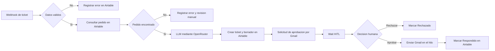

# OlistCare AI

Ecosistema autonomo de triage y respuesta para reclamos por entregas de Olist. El flujo recibe un ticket, valida los datos, consulta la memoria operativa en Airtable, usa un LLM mediante OpenRouter para clasificar el caso y redactar una respuesta, solicita aprobacion humana por Gmail y, solo si la respuesta es aprobada, envia el correo al cliente.

## Caso de uso

Una tienda que opera con un modelo similar a Olist recibe reclamos por pedidos demorados. El equipo necesita priorizar los casos urgentes, responder con el contexto real del pedido, evitar promesas inventadas y mantener trazabilidad de cada decision.

## Tecnologias integradas

| Capa | Tecnologia | Funcion |
|---|---|---|
| Orquestacion | n8n | Ejecuta el flujo principal y el manejador global de errores |
| Memoria | Airtable | Guarda pedidos, clientes, tickets y errores relacionados |
| Procesamiento IA | OpenRouter | Clasifica prioridad, sentimiento y genera un borrador JSON estructurado |
| Validacion humana | Gmail + n8n Wait | Envia enlaces para aprobar o rechazar antes del contacto |
| Salida | Gmail API | Envia la respuesta aprobada y conserva el `threadId` cuando existe |

## Arquitectura resumida



## Estructura del repositorio

```text
AIAutomation-OlistCareAI/
|-- README.md
|-- arquitectura/
|   `-- Arquitectura_OlistCare_AI.pdf
|-- airtable/
|   |-- schema_reference.json
|   `-- templates/
|-- config/
|   `-- .env.example
|-- docs/
|   |-- 01_CONFIGURACION_PASO_A_PASO.md
|   |-- 02_MODELO_DATOS_AIRTABLE.md
|   |-- 03_PRUEBAS_Y_EVIDENCIAS.md
|   |-- 04_GUION_VIDEO_3_MIN.md
|   |-- 05_PROMPT_IA.md
|   |-- 06_CHECKLIST_ENTREGA.md
|   `-- ENLACES_ENTREGA.md
|-- evidencias/
|-- n8n/
|   |-- 01_OlistCare_AI_Principal.json
|   `-- 02_OlistCare_AI_Error_Handler.json
|-- scripts/
|-- tests/
|   |-- payloads/
|   `-- RESULTADOS_ESPERADOS.md
`-- .gitignore
```

## Puesta en marcha rapida

1. Crear la base de Airtable siguiendo [el modelo de datos](docs/02_MODELO_DATOS_AIRTABLE.md) e importar los CSV de `airtable/templates`.
2. Copiar `config/.env.example` a la configuracion de variables de n8n y completar los secretos fuera del repositorio.
3. Importar los dos workflows de `n8n/`.
4. En n8n, abrir el workflow principal, seleccionar el workflow de errores en **Settings > Error workflow** y guardar.
5. Activar ambos workflows y copiar la URL de produccion del Webhook.
6. Ejecutar los cinco casos de prueba con `scripts/test_webhook.ps1`.
7. Reemplazar los marcadores de [ENLACES_ENTREGA.md](docs/ENLACES_ENTREGA.md), capturar las evidencias reales y grabar el video.

Para publicar, seguir [07_SUBIR_A_GITHUB.md](docs/07_SUBIR_A_GITHUB.md).

La guia completa esta en [01_CONFIGURACION_PASO_A_PASO.md](docs/01_CONFIGURACION_PASO_A_PASO.md).

## Reglas de seguridad

- No se incluyen tokens, credenciales ni datos personales reales.
- Las acciones criticas pasan por una espera HITL antes del envio.
- El campo `automation_source` evita que los mensajes generados vuelvan a disparar el flujo.
- El prompt prohibe inventar fechas, reembolsos o compensaciones.
- Los errores de IA y Gmail se guardan en Airtable para su revision.
- Las variables sensibles se leen desde el entorno de n8n.

## Estado de las evidencias

El repositorio incluye diagramas tecnicos, el workflow exportado y una guia de capturas. Las evidencias reales se guardan por separado y nunca deben mostrar tokens o credenciales.

## Entrega

Subir esta carpeta a un repositorio publico de GitHub. Antes de entregar, completar el enlace de Airtable en modo lectura, agregar las capturas reales en `evidencias/ejecucion-real/` y verificar el checklist final.

- [Repositorio del proyecto](https://github.com/pauwelsserrato-droid/AIAutomation-OlistCareAI)
- [Vista de Airtable en modo lectura](https://airtable.com/appTpUjci4Aj48KNR/shrRBt8lKLyePUH0y)
- [Video demostrativo](https://drive.google.com/file/d/1U5sE3KnQG-dQnZtTOe8FCTOv38U2JsSr/view?usp=drive_link)
